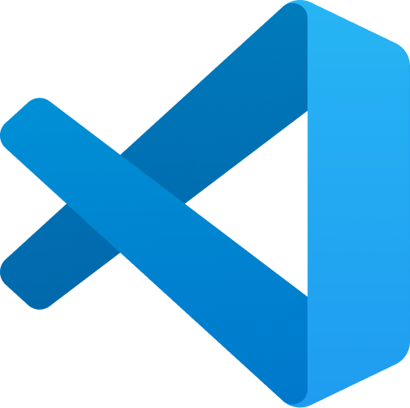

# Hello, I'm Lorenzo!

### Mechatronic Engineer | Working with Control systems, Robotics, Simulation and Autonomous vehicles

---

### 🧑🏻‍💻 About Me

Mechatronics engineer with a solid mechanical background, keen on Control Systems, Robotics, Simulation and Autonomous vehicles

- 🔭 Currently working as an **ADAS Performance Feature Designer** at Stellantis for Teoresi Group
- 🔍 Previously **Advanced Vehicle Dynamics Intern** at Danisi Engineering, **Research & Development Intern** at Thales Alenia Space
- 🎓 MSc in Mechatronic Engineering (Technologies for eMobility)
- 🎓 BSc in Mechanical Engineering
- ⚡ Passionate about computer science and innovative design

---

### ⚙️ Projects

- [Sizing of a power conversion system for xEV](https://github.com/lorenzovadacca/Sizing-of-a-power-conversion-system-for-xEV.git) : MATLAB/Simulink simulation and control of an electric vehicle powertrain, integrating a bidirectional DC/DC boost converter and an IPM motor drive with FOC, MTPA and field-weakening strategies.
- [Piece-counting system with a conveyor belt](https://github.com/lorenzovadacca/Piece-counting-system-with-conveyor-belt.git) : Electro-pneumatic simulation and control of an automated piece-counting conveyor belt in Automation Studio, implemented with Grafcet, state-transition Ladder logic, HMI animation, and safety/homing routines.
- [Bottle filling and sorting system](https://github.com/lorenzovadacca/Bottle-filling-and-sorting-system.git) : Co-simulation and control of an automated multi-beverage filling, corking, and sorting line using CODESYS (LD, ST, FBD) and FluidSIM via EzOPC, featuring batch buffering, safety routines, and an interactive animated HMI.
- [ROS interfacing publisher and subscriber messaging, kinematics control](https://github.com/lorenzovadacca/ROS-interfacing-publisher-subscriber-messaging-kinematics-control.git) : MATLAB-based ROS 1 implementation of node architectures, custom pub/sub messaging, service-client communications, and closed-loop kinematic control for mobile robot teleoperation and odometry tracking.
- [Robot modeling and vision-guided autonomous pick & place](https://github.com/lorenzovadacca/Robot-modeling-and-vision-guided-autonomous-pick-and-place.git) : Autonomous pick-and-place manipulation using a Kinova Gen3 arm in Gazebo, coordinated via ROS 1 and MATLAB/Stateflow with YOLOv2 visual detection, dynamic TF tree tracking, and IK-based trajectory generation.
- [Driving monitoring system](https://github.com/lorenzovadacca/Driving-monitoring-system.git) : Real-time driver monitoring system in Python using OpenCV and MediaPipe Face Mesh, featuring 3D head pose and gaze estimation via solvePnP, EAR-based blink tracking, and PERCLOS/distraction alert detection.
- [Comparison between Dijkstra and A* algorithms for motion planning](https://github.com/lorenzovadacca/Comparison-between-Dijkstra-and-Astar-algorithms-for-motion-planning.git) : Python implementation of Dijkstra and A* algorithms using OSMnx for time-optimal autonomous vehicle routing on the Turin road network, featuring travel-time edge weighting, euclidean heuristics, and comparative search heatmap visualization[cite: 3].

---

### 🛠️ Skills

#### Control systems & model-based design

  
  &nbsp;
  

#### Autonomous vehicles, simulation & robotics

  
  &nbsp;
  
  &nbsp;
  
  &nbsp;
  
  &nbsp;
  

#### Mechanical design

  
  &nbsp;
  
  &nbsp;
  

#### Industrial automation

  
  &nbsp;
  
  &nbsp;
  
  &nbsp;
  

#### Programming languages & development tools

  
  &nbsp;
  
  &nbsp;
  
  &nbsp;
  
  &nbsp;
  

